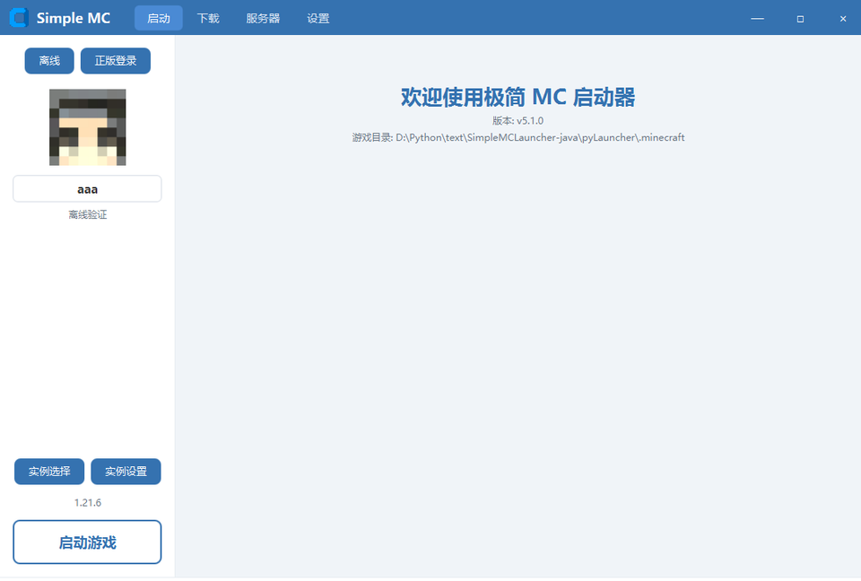

# 极简 MC 启动器 · Simple MC Launcher

免费、开源、无广告的 Minecraft 启动器（JavaFX 版）。

一键安装原版与 Fabric / Forge / Quilt / NeoForge，从 Modrinth 查找模组与整合包，
拖拽即可导入，内置服务器面板，在一个地方完成下载、更新与备份。



## 下载

| 平台 | 文件 |
|------|------|
| Windows | `SimpleMCLauncher-*-windows.zip` 或 `.exe` 安装包 |
| macOS | `SimpleMCLauncher-*.dmg` |
| Linux | `simplemc-launcher_*_amd64.deb` |

到 [Releases](https://github.com/BoscoWu/Simple-Minecraft-Launcher-SCL-/releases) 页面下载对应版本。
已内置 Java 21 运行时，**无需自行安装 Java**。

### 安装

- **Windows**：解压 zip 后运行 `SimpleMCLauncher.exe`；或直接运行 `.exe` 安装包
- **macOS**：打开 `.dmg`，把启动器拖进 Applications。首次打开若提示「无法验证开发者」，右键点击 → 打开
- **Linux**：`sudo dpkg -i simplemc-launcher_*_amd64.deb`

## 功能

### 版本与加载器
- 923 个官方版本的完整清单，分「正式版 / 预览版 / 远古版 / 愚人节版」四组折叠展示
- 愚人节版按 **4 月 1 日发布日期**自动归集（15w14a、1.RV-Pre1、3D Shareware v1.34、20w14infinite、21w13a、22w13oneblockatatime、23w13a_or_b、24w14potato、25w14craftmine、26w14a）
- Forge / NeoForge / Fabric / Quilt 各自列出真实可用版本
- 装好加载器后实例自动带可读名称，如 `1.21.1 - Fabric 0.20.1`

### 内容管理
- Modrinth 集成：模组、整合包、数据包、资源包、光影、世界、收藏夹
- 整合包导入：支持 `.mrpack` 与 `.zip`，**拖到窗口任意位置**即可导入
- 每个整合包/加载器实例独立目录，互不干扰

### 下载
- 多线程分片下载，并发数可在设置里调整（1-32）
- 官方 CDN 优先，BMCLAPI 镜像自动回退
- HTML 响应识别与拒绝、SHA1 校验、断点续传
- 失败自动重试（TLS 握手失败 / 超时 / 429 限流）

### 实例管理
- 左侧文件夹列表 + 右侧可搜索列表
- 收藏、打开目录、删除、实例设置

### 服务器
- Java 版服务端下载（原版 / Paper / Fabric）
- 控制台实时日志与命令发送
- EULA 确认、干净停止（含孤儿进程清理）

### 其他
- Microsoft 正版登录（设备代码流）与离线模式
- 离线玩家名直接编辑，回车保存
- Java 自动检测与下载安装（Adoptium）
- 游戏语言自动设为简体中文
- Windows 10 直角界面 / Windows 11、macOS、Linux 圆角界面
- 全文中文界面

## 从源码运行

需要 JDK 21。

```bash
./mvnw compile
```

Windows 下双击 `启动.cmd`；或手动：

```powershell
.\launch.ps1
```

## 构建安装包

需要 JDK 21 与 `jpackage`。

```bash
./build.sh
```

产物在 `target/dist/`。

- Windows 需要 [WiX Toolset](https://wixtoolset.org/) 才能生成 `.exe` 安装包；没有 WiX 时生成便携版 zip
- macOS 生成 `.dmg`
- Linux 需要 `fakeroot`，生成 `.deb`

推送到 `v*` tag 会触发 GitHub Actions 在三个平台各自构建并发布到 Release。

## 目录结构

```
src/main/java/com/simplemc/launcher/
├── LauncherApp.java          程序入口
├── core/
│   ├── VersionManager.java   版本清单
│   ├── VanillaInstaller.java 原版下载安装
│   ├── LoaderInstaller.java  Fabric/Forge/NeoForge/Quilt
│   ├── GameLauncher.java     启动游戏（合并 inheritsFrom）
│   ├── InstanceManager.java  实例与整合包导入
│   ├── JavaManager.java      Java 检测与安装
│   ├── AccountManager.java   正版/离线账户
│   ├── Modrinth.java         Modrinth API
│   ├── ServerManager.java    服务端管理
│   └── UpdateManager.java    自动更新
├── ui/
│   ├── MainWindow.java       主窗口与全局拖拽
│   ├── Theme.java            主题与样式
│   ├── SplashScreen.java     启动闪屏
│   └── page/                 各页面
└── util/
    ├── Config.java           配置（损坏自动修复）
    ├── Downloader.java       多线程下载
    ├── Http.java             HTTP 与镜像
    ├── Log.java              日志
    └── Constants.java        常量与平台检测
```

数据目录为程序同级的 `pyLauncher/`，游戏目录为 `pyLauncher/.minecraft`。
与 Python 版共享同一数据格式，可直接迁移。

## 许可证

LGPL-2.1
